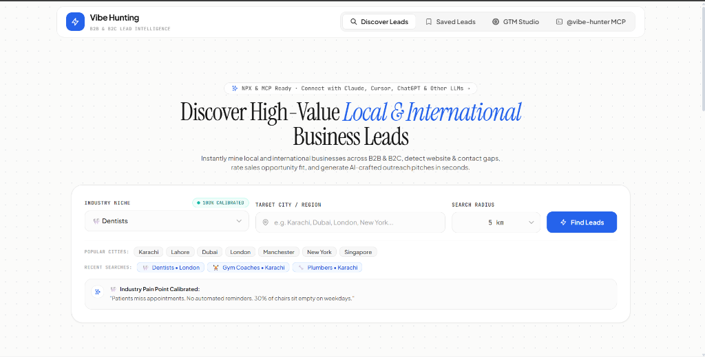
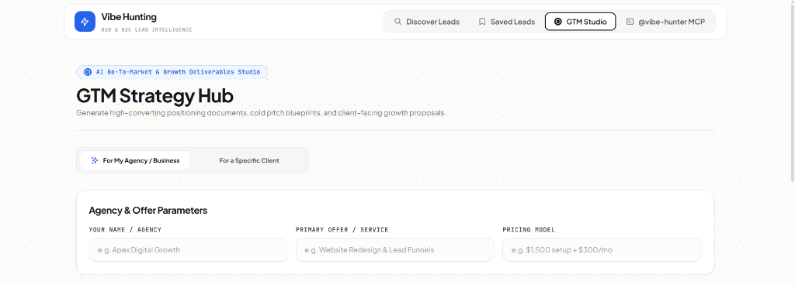
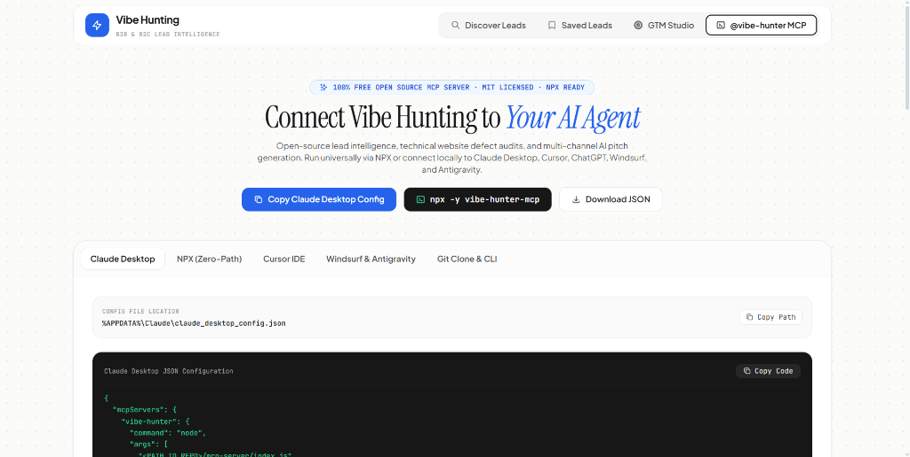

# ⚡ Vibe Hunting

**100% Free & Open-Source B2B Lead Intelligence, Technical Gap Auditing & GTM Strategy Hub.**

Find local businesses anywhere in the world, discover which ones are missing websites or booking systems, and generate high-converting sales pitches with AI — without paying any API subscription fees.

---

## 📸 Screenshots & Overview

### 1. Discover High-Value Local & International Leads
Search any business niche (dentists, plumbers, gyms, salons, restaurants) across any city worldwide.


### 2. GTM Strategy & Deliverables Studio
Create 12+ professional business strategy documents, client proposals, and pitch playbooks in seconds.


### 3. Connect to Other LLMs & AI Agents via MCP
Connect Vibe Hunting directly into Claude Desktop, Cursor IDE, ChatGPT, Windsurf, and Antigravity using the open Model Context Protocol (MCP).


---

## ✨ Key Features

- **🌍 Global Open Data Lead Mining**: Search over 100+ business niches in any city or country using OpenStreetMap open data (0 API fees, no Google Maps billing).
- **🎯 Smart Opportunity Rating (0–100 Score)**: Automatically rates every business to highlight high-value prospects that need new websites, online booking funnels, or marketing help.
- **🔍 Deep Website & Technical Audit**: Automatically crawls websites to detect broken SSL certificates, missing mobile optimization, missing contact forms, and extracts direct phone numbers, WhatsApp links, and emails.
- **✍️ 5-Channel AI Cold Outreach**: Automatically drafts tailored pitches for **Cold Email**, **WhatsApp**, **Phone Cold Calling Script**, **LinkedIn DM**, and **3-Touch Follow-up Sequences** using Groq's super-fast Llama 3.3 70B model.
- **📊 GTM Strategy Studio**: Generate complete Go-To-Market strategies, Ideal Customer Profiles (ICP), Buyer Personas, Competitive Battlecards, and Pricing One-Pagers.
- **🤖 Built-in MCP Server**: Use `@vibe-hunter` in Cursor, Claude Desktop, or Windsurf to hunt leads directly inside your favorite AI coding environment.

---

## 📦 Prerequisites

Before installing, make sure you have the following installed on your computer:

1. **Node.js** (version 18.0 or newer) — [Download Node.js](https://nodejs.org/)
2. **Git** — [Download Git](https://git-scm.com/)

---

## 🚀 Easy Installation Guide (3 Simple Steps)

### Step 1: Clone the Repository
Open your Terminal or PowerShell and run:
```bash
git clone https://github.com/farooq58-collab/vibe-hunting.git
cd vibe-hunting
```

### Step 2: Install Dependencies
Install all required packages with one command:
```bash
npm install
```

### Step 3: Start the Development Server
```bash
npm run dev
```
Now open your web browser and visit:
👉 **`http://localhost:3000`**

That's it! The application will load immediately.

---

## 🔑 API Keys & Configuration

> **Important:** Vibe Hunting does **not** include built-in OpenStreetMap API endpoints. **You must add your own OpenStreetMap API endpoints (`OVERPASS_API_URL` and `NOMINATIM_API_URL`) in `.env.local` in order to fetch leads.**

### Step 1: Create `.env.local`
```bash
cp .env.example .env.local
```

### Step 2: Add Your OpenStreetMap APIs (Required to Fetch Leads)
Open `.env.local` in your code editor and add your own OpenStreetMap Overpass and Nominatim API endpoints:

```env
# 1. OpenStreetMap APIs (REQUIRED to fetch leads)
# Add your own Overpass API endpoint(s) and Nominatim geocoding API endpoint
OVERPASS_API_URL=https://your-overpass-instance.example.com/api/interpreter
NOMINATIM_API_URL=https://your-nominatim-instance.example.com/search
NOMINATIM_CONTACT=your-email@example.com
```

### Step 3: Optional Free API Keys (AI Outreach & Cloud CRM)
Without `GROQ_API_KEY` or Supabase, Vibe Hunting runs in **Local Mode** (saved leads are stored in your browser's `localStorage`, and website auditing runs locally). To unlock AI cold outreach emails and GTM strategy documents, add:

```env
# 2. AI Generation (Free 14,400 requests/day)
# Get your free key at: https://console.groq.com/keys
GROQ_API_KEY=your_groq_api_key_here

# 3. Database & Cloud CRM (Optional — Free forever)
# Get free project URL & anon key at: https://supabase.com
NEXT_PUBLIC_SUPABASE_URL=
NEXT_PUBLIC_SUPABASE_ANON_KEY=
```

#### How to get a free Groq API key:
1. Go to [https://console.groq.com](https://console.groq.com) and sign up with Google or GitHub (Free).
2. Click **API Keys** on the left menu.
3. Click **Create API Key**, copy it, and paste it into `GROQ_API_KEY=` in `.env.local`.

---

## 🤖 Connect to Other LLMs (Claude, Cursor, ChatGPT)

Vibe Hunting comes with a built-in **Model Context Protocol (MCP)** server so you can control it with external AI assistants.

### 1. NPX (Zero-Configuration — Easiest Way)
Add this to your Claude Desktop or Cursor MCP configuration file:
```json
{
  "mcpServers": {
    "vibe-hunter": {
      "command": "npx",
      "args": ["-y", "vibe-hunter-mcp"]
    }
  }
}
```

### 2. Run Locally from Source
```json
{
  "mcpServers": {
    "vibe-hunter": {
      "command": "node",
      "args": ["/absolute/path/to/vibe-hunting/mcp-server/index.js"]
    }
  }
}
```

Once connected, you can simply type in Cursor or Claude Chat:
> *"@vibe-hunter find 10 dentists in London who do not have a website and write WhatsApp pitches for them."*

---

## 🛠️ Project Scripts

| Command | What it does |
|---|---|
| `npm run dev` | Starts local Next.js development server at `http://localhost:3000` |
| `npm run build` | Compiles the production build |
| `npm run start` | Runs the production build server |
| `npm run mcp` | Runs the standalone MCP server for AI clients |

---

## 🧩 Tech Stack & Dependencies

- **Framework**: [Next.js 14](https://nextjs.org/) (App Router)
- **UI & Styling**: [React 18](https://react.dev/) + [Tailwind CSS](https://tailwindcss.com/)
- **Lead Intelligence**: [OpenStreetMap Overpass API](https://wiki.openstreetmap.org/wiki/Overpass_API) (Free & Open)
- **Geocoding**: [Nominatim](https://nominatim.org/) (Open geographic coordinates)
- **Website Auditing**: [Axios](https://axios-http.com/) + [Cheerio](https://cheerio.js.org/)
- **AI Engine**: [Groq](https://groq.com/) running `llama-3.3-70b-versatile`
- **Optional Cloud CRM**: [Supabase](https://supabase.com/) (PostgreSQL + Row-Level Security)
- **LLM Integration**: [@modelcontextprotocol/sdk](https://modelcontextprotocol.io/)

---

## 🤝 Contributing

Contributions, issues, and feature requests are welcome!
Feel free to check the [issues page](https://github.com/farooq58-collab/vibe-hunting/issues).

1. Fork the Project
2. Create your Feature Branch (`git checkout -b feature/AmazingFeature`)
3. Commit your Changes (`git commit -m 'Add some AmazingFeature'`)
4. Push to the Branch (`git push origin feature/AmazingFeature`)
5. Open a Pull Request

---

## 📄 License

This project is licensed under the **MIT License** — free to use for personal and commercial projects.
